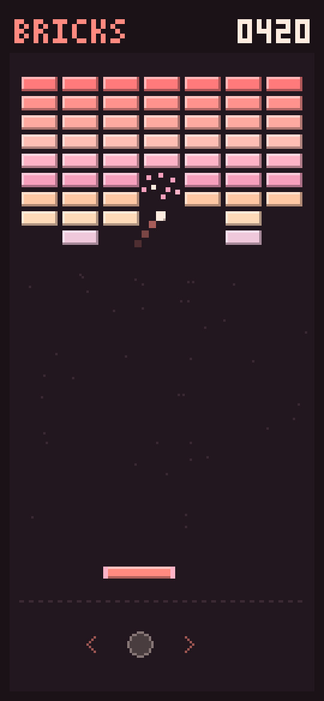
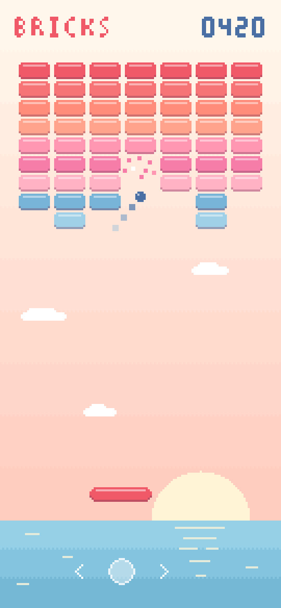
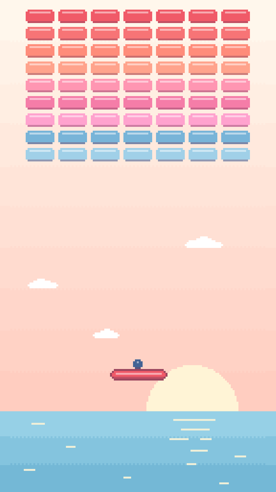
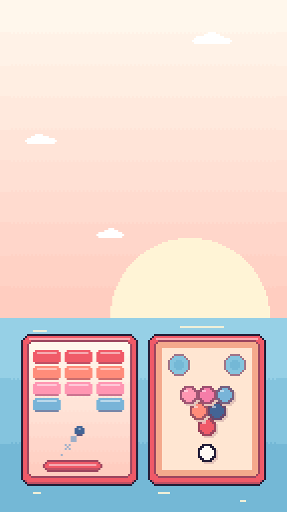
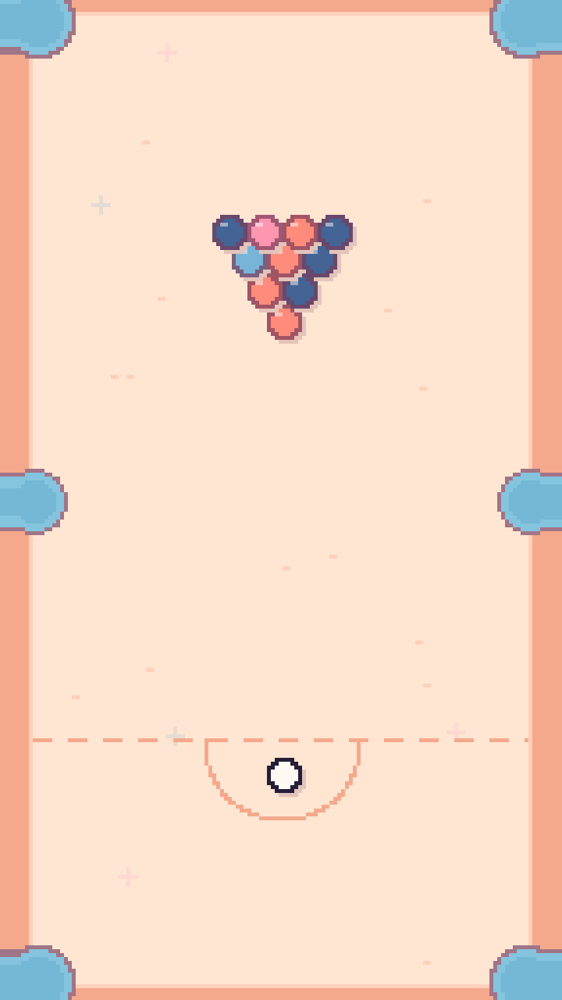
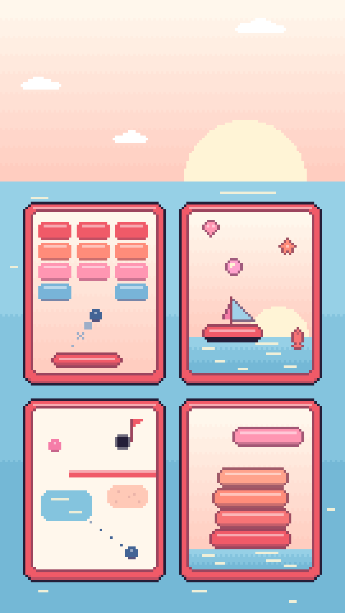
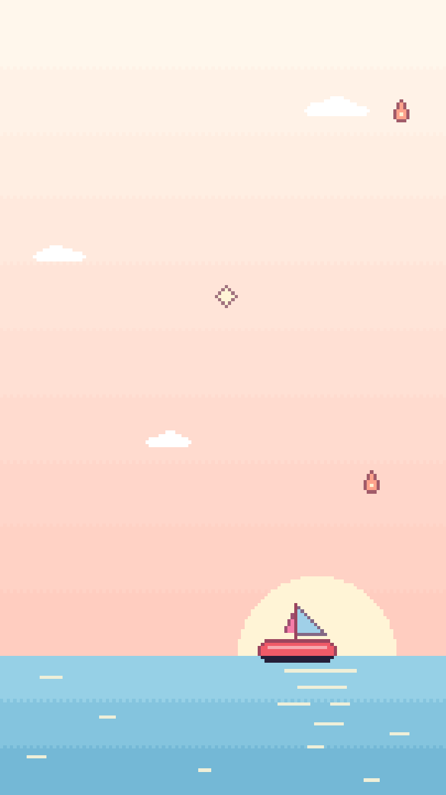
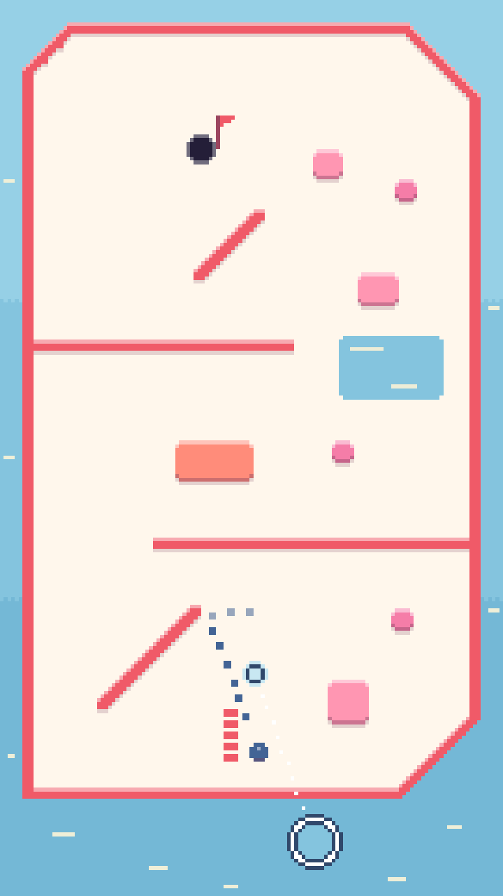
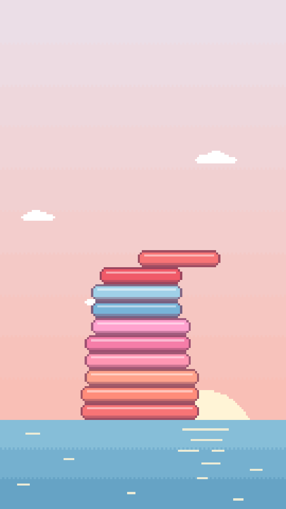

## Problem

I wanted something on my phone that was not a feed, for the end of a day when my head is full. I had looked at retro gaming handhelds more than once and always stopped at the same point: **I would not know which games to play.** So I described the feeling and asked what it would cost to build.

> "Something that is semi-dynamic, but it's relaxing. Goes on for ages, I can pick up and put down, that does not require brain, just, you know, relaxed engagement."

The AI answered with one recommendation: a brick-breaker you cannot lose, as the first game of a small arcade, with its cost in build chats. I asked for a picture before any plan.





## Strategy

- **Android only.** One sentence from me removed every iPhone workaround, including the only obstacle to haptics.
- **No sound.** Short vibration ticks replace it.
- **No way to lose.** No lives, no game over, no timers, no streaks, no notifications.
- **Controls sized to a thumb.** The drag is relative, so the thumb rests in the sea and never covers the play.

### The AI adds. My job was to subtract.

Left alone, each spec grew: a score, a run counter, a back button, a restart button, a haptics switch, saved games. All reasonable, and none of it what I had asked for. I removed the lot in two messages.

> "The idea is to have the app be as simple as possible, no numbers, options, just pick up and swipe, tap, aim."

The rules that came out of it: **no points, no buttons, no saved state, no settings, no text.** Going home is the Android back gesture.

```diagram
feature-gate
```

## Evidence

I did not want a game that only felt calming. I asked the AI to research what helps a busy mind switch off after work, and to judge our own design against it.

| What the research said | What changed in the product |
|---|---|
| A too-easy game bores people as surely as a too-hard one frustrates them (Sweeny and colleagues, 2018). | The first plan fixed the ball at one constant speed. Each game got one hidden pace that rises while play is clean and drops after a miss. It is never shown. |
| Recovery after work runs on detachment and a sense of mastery. | With all points gone, mastery has to come from the play itself. |
| Stopping has to be easy. | Over ten minutes of play the sunset moves to dusk in ten steps and the game eases down. Nothing locks and nothing is said. |

**It also said where the evidence stops.** The studies are small and none tested games like these as an evening wind-down. So rlx is described as a calm game and makes no health claim.

## Product






```diagram
ia
```

### v1 was five games






On the third day I cut it to two. "I'm overthinking it." Catch, Putt, Stack and Glide are archived on a branch; Putt's pull-back shot became Pool's.

## Leadership

The process can do everything except play the game on a phone. So the tuning loop waited for my feel reports, each one a sentence.

| I said | It became |
|---|---|
| "Bricks still needs too much thumb amplitude." | Thumb travel cut from 50 to 35 percent of the screen width. |
| "Same for catch", then smaller "by about 20%" | One shared value for both games, set to 28 percent. |
| Putt: "not so much pulling to reach full power" | The pull cap went from 60 to 48 px. |
| The homepage is "boring" | Four hub mockups with no app name. I picked the grid of cards. |
| "Cards at thumb reach, illustration on the sky above" | A reviewer had flagged the top row as out of one-thumb reach. The grid moved down onto the sea, with the sunset above it. |
| "There's no pause button which now isn't needed" | The last on-screen marker was removed. Pausing itself did not change. |
| "I need something that gets approved on Google Play" | Research first: target API level, the closed-test rule for new accounts, the risk of a bare website wrapper. Then a bundled app with native haptics that works offline. |

One design change came from a measurement. A contrast test failed on the dusk sea, so each card's outer edge changed colour until it passed. **"It's pastel but contrast is important"** was my rule, and a script enforces it.

```diagram
tuning
```

## Orchestration

The plan lives in the repo. A cheap model runs each build chat and stays thin. A fresh agent builds, and a second that never saw the build reviews it. Every finding is fixed before a row closes, and every chat ends by printing the starter for the next.

```diagram
loop
```

**One change from Groovebox.** There, the design chat pushed to the main branch while a build was running. Here the design chat never touches the repo. It writes a bundle, I upload it between builds, and the upload merges it into the plan without replacing anything.

Each game's simulation runs without a screen, so it can be tested for simulated minutes of play in seconds, next to a browser suite that measures contrast and compares frames pixel for pixel.

## Where it went wrong

- **A rule the evidence contradicted.** "Constant speed, never accelerates" went into the first plan with full confidence. Twenty minutes later its own research overturned it.
- **A dark first screen.** It reached for a dark theme by habit. I wanted a summer day.
- **Features nobody asked for.** Scores, counters, buttons, a settings switch. It flagged some as its own additions, which made them easy to cut.
- **An agent loop I had to stop.** The Android build failed four times in a row on the build server, each a step further. The agent then added an emulator test nobody asked for and kept iterating on it, on my budget.
- **Store assets that would have been refused.** Screenshots at a ratio Google Play rejects, a listing claim two of the games did not back, and a signing check that would have passed an unsigned file. All caught by the reviewer.
- **A wrong number in its own documentation.** The builder wrote the contrast standard as half of what the tests enforce. The reviewer found it.

> "Yours to own and mine to pay in token usage."
> -- me, while the build kept failing. Then: "Just do it right."

**What I took from it:** an unattended agent loop needs a scope fence and a stop rule, and the person paying should not have to ask twice.

The records are honest about the rest. My install confirmed that v1 installs, runs and plays well. For v2, nothing is confirmed on a phone yet: pull length, break strength, roll, pocket size and the dark theme are listed as open checks.
